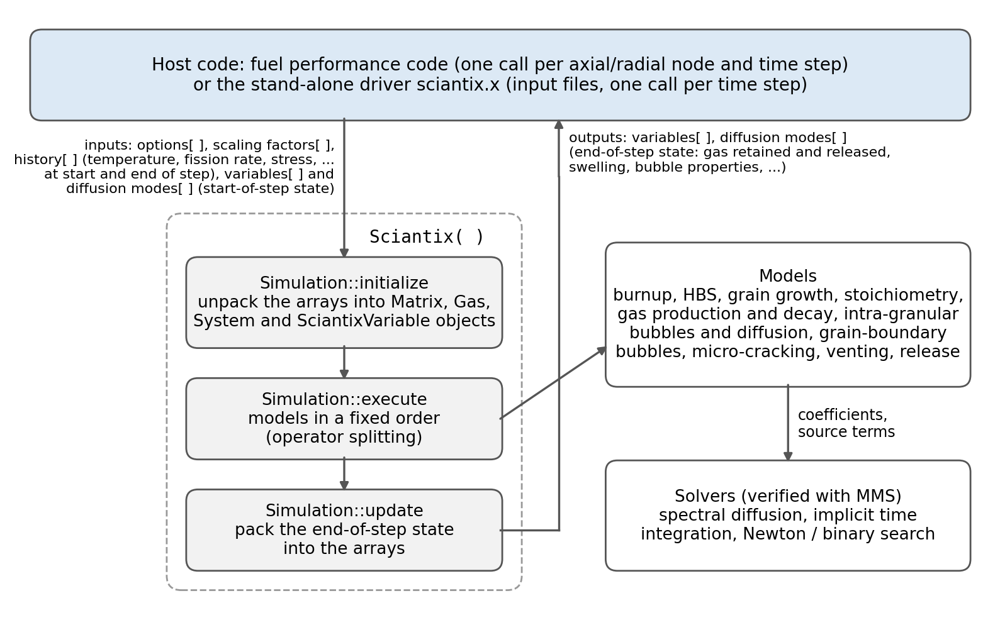

.. _coupling:

Coupling with a fuel performance code
=====================================

SCIANTIX can be embedded in a fuel performance code (FPC), which calls it at each time step for each
computational node of the fuel (for example, each radial and axial node of a fuel rod). This page
describes the interface, for developers who know their own FPC well and want to couple it to SCIANTIX.

   Architecture of SCIANTIX and its interface with a host code.

Building the library
--------------------

.. code-block:: bash

    cmake -S . -B build -DCOUPLING_TU=ON
    cmake --build build

This builds the static library ``build/libsciantix.a`` instead of the executable, to be linked with the FPC.

Entry points
------------

The interface consists of two functions with C linkage, declared in ``include/coupling/TUSrcCoupling.h``,
which can therefore be called from C, C++ and Fortran (through ``ISO_C_BINDING``):

``getSciantixOptions(options, scaling_factors, thermochemistry, thermochemistry_settings)``
    Called once at the start of the calculation. It reads ``input_settings.txt`` and, if present,
    ``input_scaling_factors.txt`` from the working directory, and fills the arrays of options and
    scaling factors. The options are the same as in a stand-alone calculation
    (see :ref:`input_settings.txt <input-settings>`), except ``Number_of_time_steps_per_interval``: the
    time discretisation is that of the FPC.

``callSciantix(options, history, variables, scaling_factors, diffusion_modes, thermochemistry, thermochemistry_settings)``
    Called at each time step, for each node. It advances the state of the node from the beginning
    to the end of the time step.

Data exchanged
--------------

All the arrays are owned by the FPC. Their sizes are set in ``include/MainVariables.h``.

``options`` (int)
    Model options, as read by ``getSciantixOptions``. The same for all nodes.

``history`` (double)
    Local conditions of the node at the beginning and end of the time step, set by the FPC before each call:

    ========  =============================================  =======================
    Index     Quantity                                       Unit
    ========  =============================================  =======================
    0, 1      temperature (beginning, end of step)           K
    2, 3      fission rate (beginning, end of step)          fiss/(m\ :sup:`3`\ s)
    4, 5      hydrostatic stress (beginning, end of step)    MPa
    6         time step                                      s
    7         time                                           h
    8         time step number                               --
    9, 10     steam pressure (beginning, end of step)        atm
    11, 12    system pressure (beginning, end of step)       Pa
    13, 14    O/M ratio (beginning, end of step)             --
    ========  =============================================  =======================

    Steam pressure, system pressure and O/M ratio are used only by the models that need them
    (fuel oxidation, thermochemistry, prescribed stoichiometry).

``variables`` (double)
    State of the node: grain radius, gas produced, in the grains, at the grain boundaries and
    released, bubble properties, swelling, and so on. The FPC sets the initial values once, keeps one
    array per node, and passes it at each call: on input it holds the state at the beginning of
    the step, on output the state at the end. The position of each variable is fixed and listed in
    ``initializeSciantixVariable`` (``src/operations/SetVariablesFunctions.C``); new variables are
    added at new positions, so that existing couplings are not affected.

``diffusion_modes`` (double)
    Coefficients of the spectral solution of intra-granular diffusion. Like ``variables``, one array
    per node, initialised to zero and passed back at each call.

``scaling_factors`` (double)
    Scaling factors of the model parameters (see the Input Files page). The same for all nodes.

``thermochemistry``, ``thermochemistry_settings``
    Used only when thermochemistry is enabled (``iThermochimica``); otherwise an array of zeros and a
    null pointer.

Typical coupling
----------------

1. At the start of the calculation, call ``getSciantixOptions`` and allocate ``variables`` and
   ``diffusion_modes`` for each node, with the initial conditions in ``variables`` (e.g. the initial
   grain radius at position 0).
2. At each time step and for each node, fill ``history`` with the local conditions computed by the
   FPC, call ``callSciantix``, and read the results from ``variables``.
3. Use the results in the FPC: for example, the gas released goes to the rod free volume and the
   gaseous swelling to the fuel strain.

SCIANTIX keeps no state between calls other than the arrays passed by the FPC, so the nodes are
independent and the order of the calls does not matter. The stand-alone executable
(``src/MainSCIANTIX.C``) is itself a driver of this kind, with a single node and the history read
from ``input_history.txt``, and can be used as a reference implementation.

Existing couplings
------------------

SCIANTIX is coupled with TRANSURANUS, OFFBEAT and FRAPCON/FRAPTRAN; see :doc:`publications` for the
corresponding papers. For access to a coupled version of one of these codes, contact the developers
through the `issue tracker <https://github.com/sciantix/sciantix-official/issues>`_.
