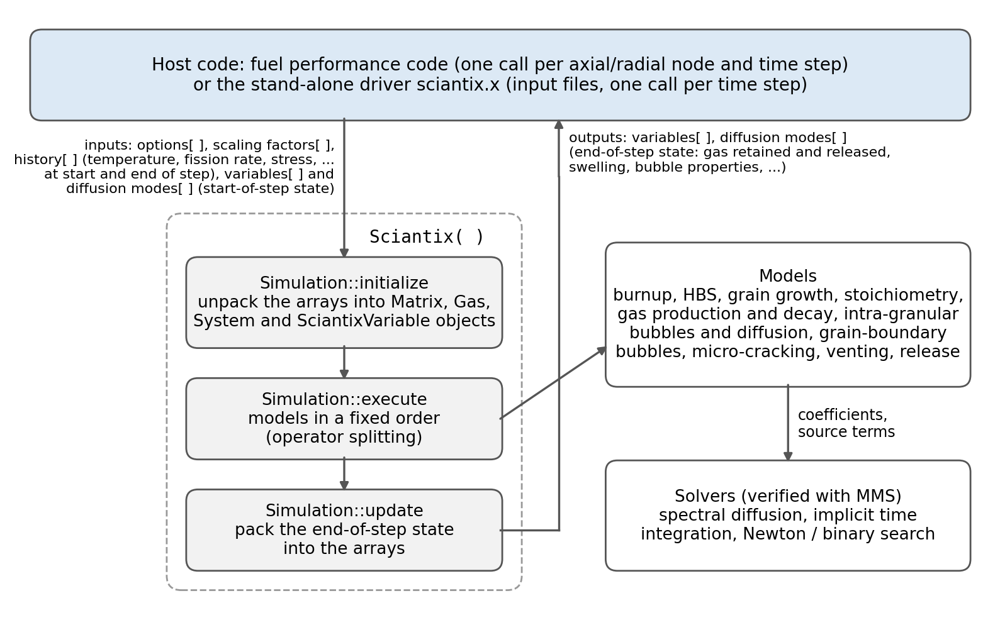

# Summary

Fission gases produced during nuclear reactor operation strongly influence fuel swelling, pressure build-up, and overall fuel performance. Fission gas release raises the rod internal pressure and degrades the thermal conductance of the fuel-cladding gap, while gaseous swelling contributes to the mechanical interaction between pellet and cladding; both limit the power and burnup at which a fuel rod can be operated safely. Predictive modelling of these processes is therefore needed to design fuel rods and to justify their operating limits, in particular for new fuels and irradiation conditions for which experimental data are scarce. SCIANTIX is an open-source multi-scale code for modelling fission gas behaviour in oxide nuclear fuel, together with the relevant microstructural phenomena. The code behaves as a 0D meso-scale solver implementing physics-based rate-theory models, designed to be either a stand-alone tool for separate-effect calculations or a module embedded in engineering thermo-mechanical Fuel Performance Codes (FPCs). SCIANTIX is a design and analysis tool: it simulates the fuel behaviour for a given irradiation history, and it is not intended for the online monitoring of operating reactors. Compared with the empirical approaches commonly used in FPCs, SCIANTIX solves evolutionary equations for stable and radioactive intra-granular gas diffusion, trapping, re-solution, grain-boundary bubble evolution, diffusional and burst release, helium behaviour and high-burnup structure (HBS) porosity. The code adopts verified numerical solvers and includes a regression suite to ensure reproducibility.

# Statement of need

Engineering FPCs typically rely on empirical correlations for modelling fission gas release and gaseous swelling. The underlying physical processes are commonly described using classical rate-theory formulations [@Forsberg1985a; @Forsberg1985b], which are often simplified in engineering codes for robustness and computational speed. These implementations are usually calibrated for specific datasets or reactor conditions and are rarely available as open-source software, limiting reproducibility and research efforts for new fuel designs or irradiation scenarios.

SCIANTIX is intended for nuclear fuel performance researchers, code developers, and advanced students working on mechanistic modelling of fission gas behaviour. Since it can be embedded in any FPC through a documented interface, it can also serve research and development departments in industry, for example to bring physics-based fission gas models into in-house FPCs or to assess new fuel designs.

SCIANTIX addresses these limitations by providing an open-source physics-based meso-scale module [@Pizzocri2020], together with a modular C++ architecture that enables extensions and direct coupling to external multi-physics solvers [@Zullo2023]. The code is supported by numerical verification through the Method of Manufactured Solutions (MMS) for all employed solvers, and by a regression testing suite covering intra- and inter-granular swelling, HBS porosity, helium behaviour and radioactive gas release. A stable API facilitates its integration into engineering-scale codes, and is already used for online coupling with TRANSURANUS, FRAPCON/FRAPTRAN and OFFBEAT [@Zullo2024].

# State of the field

In engineering FPCs, fission gas behaviour is described with models of different complexity, from empirical correlations to physics-based models of intermediate complexity, such as the model of @Pastore2013 developed in TRANSURANUS. Mechanistic codes dedicated to fission gas behaviour have also been developed, such as MARGARET [@Noirot2011], part of the CEA fuel performance platform, and MFPR [@Veshchunov2006], developed by IBRAE and IRSN for fission product release in normal and accident conditions. These codes are closed-source and each is tied to a specific FPC. At lower length scales, cluster dynamics, phase-field and atomistic simulations resolve the evolution of defects and bubbles in detail, at a computational cost that does not allow their use in the thermo-mechanical analysis of a whole fuel rod; their results are rather used to derive parameters for meso-scale models.

To the authors' knowledge, SCIANTIX is the only open-source meso-scale code for fission gas behaviour designed to be coupled to different FPCs. It implements physics-based models of the same family as the codes above [@Pizzocri2020], with verified solvers, and it can be used both stand-alone, for separate-effect analyses, and within an FPC, so that the same models are applied from the analysis of single experiments to that of whole fuel rods.

# Software design

The current release of SCIANTIX (version 2.0 and above) adopts a fully object-oriented C++ structure, in which core simulation entities like matrices, gas, systems, models and solvers are implemented as independent classes. This modular abstraction improves maintainability, clarity and extensibility.

A fundamental design decision is the separation between solvers and models. This supports the independent verification and separate-effect model validation. The spectral diffusion solver provides a meshless approach with controlled numerical error for Booth-type diffusion problems. First-order L-stable implicit time integrators ensure numerical stability. A segregated operator-splitting scheme maintains CPU-time compatibility in online coupling with engineering-scale thermo-mechanical codes. These choices balance the physical fidelity, numerical robustness, and overall efficiency.

SCIANTIX is coupled to a host FPC through a single function, `Sciantix()`, called at each time step for each computational node of the fuel (\autoref{fig:architecture}). The host passes plain arrays of integers and doubles: the options that select the models, the local history (temperature, fission rate, hydrostatic stress and other conditions at the beginning and end of the time step), the state variables at the beginning of the step, the scaling factors and the coefficients of the diffusion modes. SCIANTIX returns the state at the end of the step in the same arrays. The host stores these arrays for each node, so that the same library serves any number of nodes and can be called from codes written in other languages, such as Fortran. The interface is stable because each variable has a fixed position in the arrays: new models add new positions without changing the existing ones, so that existing couplings keep working when the code is extended. The stand-alone executable is a thin driver that reads the input files and calls the same function, so stand-alone and coupled calculations run the same code.

Within a call, the models are executed in a fixed sequence: first those that set the local conditions (burnup, high-burnup structure, grain growth, stoichiometry), then gas production and decay, intra-granular bubble behaviour and diffusion, and finally grain-boundary bubble evolution, micro-cracking, venting and release. Each model uses the variables updated by the previous ones, so all the models take part in every calculation; the options select the correlation used by each model, or switch a phenomenon off for separate-effect analyses.

SCIANTIX models intra-granular diffusion, trapping and irradiation-induced re-solution; nucleation and growth of intra-granular bubbles; grain-boundary bubble growth, coalescence, saturation and fission gas release; HBS formation and porosity evolution; helium diffusion, solubility and thermal re-solution; the release of short-lived radioactive fission gases through diffusion–decay with first-precursor enhancement.

The numerical solvers are verified using the Method of Manufactured Solutions [@Oberkampf2004; @Zullo2022], with verification tests available in the repository. Separate-effect validation reproduces the published results [@Pizzocri2020; @Zullo2023] without parameter tuning and using published models and parameters.

The regression suite guarantees reproducibility: every verification and validation case of the repository is run by the automated test engine, and its output is compared with a stored reference output (gold file). A change that alters any result of a case is therefore detected, and a deliberate change of the results requires an explicit update of the gold file by the developers.

# Research impact statement

Since its first release, SCIANTIX has contributed to a growing and internationally collaborative research effort in multi-scale modelling of fission gas behaviour. Between 2020 and 2024, SCIANTIX-related work resulted in 21 peer-reviewed publications (90% of which are Open Access) involving 42 authors, including 13 publications co-authored with researchers from institutions outside Italy. These publications have accumulated 173 citations. A list of the main publications is available in the online documentation.

SCIANTIX has been integrated as a meso-scale module within established fuel performance frameworks, namely TRANSURANUS, OFFBEAT and FRAPCON/FRAPTRAN, which demonstrates practical use beyond stand-alone research applications. These couplings were developed mainly at Politecnico di Milano: the interface with TRANSURANUS was developed for the first version of SCIANTIX and adapted to version 2, the interface with FRAPCON/FRAPTRAN was developed entirely at Politecnico di Milano, and the first coupling with OFFBEAT was implemented by its developers, with the update to version 2 done at Politecnico di Milano. In general, the SCIANTIX developers implement the first interface with a host code and then maintain it, together with the developers of the host code, as both codes evolve. It has also been applied and developed within European research projects addressing advanced fuel concepts, helium behaviour and high-burnup structure evolution, namely R2CA, PATRICIA, OperaHPC and TRANSPARANT; one example are the verification activities carried out for OperaHPC reported in [@OperaHPC2025].

Together, the verified numerical solvers and the regression-testing infrastructure support the reproducibility of results across code versions and independent validation, demonstrating both current and continuing impact within the nuclear fuel modelling community.

# AI usage disclosure

Generative AI tools were used in the preparation and refinement of parts of the documentation (e.g., language polishing, structural suggestions, and formatting assistance). 

No generative AI tools were used in the development of the SCIANTIX software, in the implementation of its physical models or numerical solvers, or in the preparation of validation results.

# Author contributions

Following the CRediT taxonomy: D. Pizzocri: conceptualization, methodology, software (original version of the code); G. Zullo: software (version 2 architecture), methodology, verification, validation, maintenance; E. Cappellari: software, validation, documentation; G. Nicodemo: software, validation; A. Zayat: software (numerical solvers), verification; L. Luzzi: supervision, funding acquisition, writing - review and editing. All authors contributed to writing the manuscript.

# Acknowledgements

The authors thank T. Barani, co-developer of the original version of SCIANTIX, and the students and external contributors who reported issues and contributed fixes and improvements to the code.

# References
