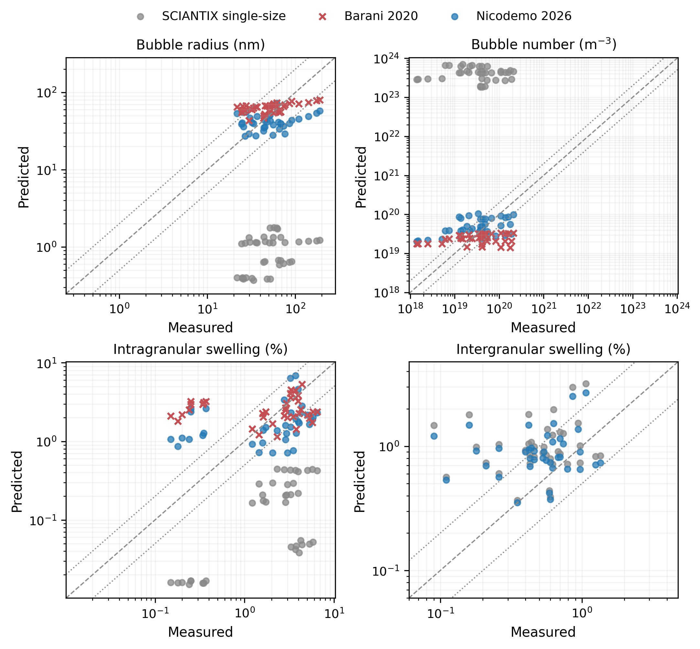
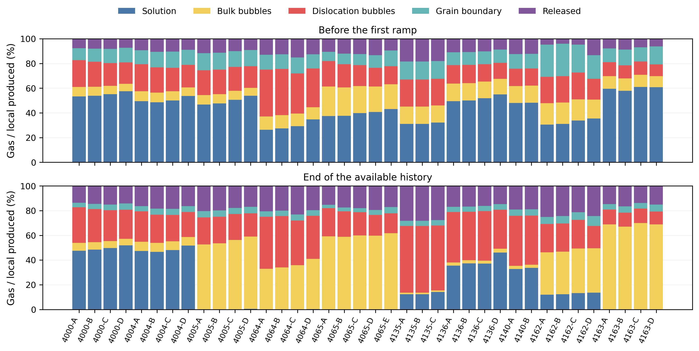
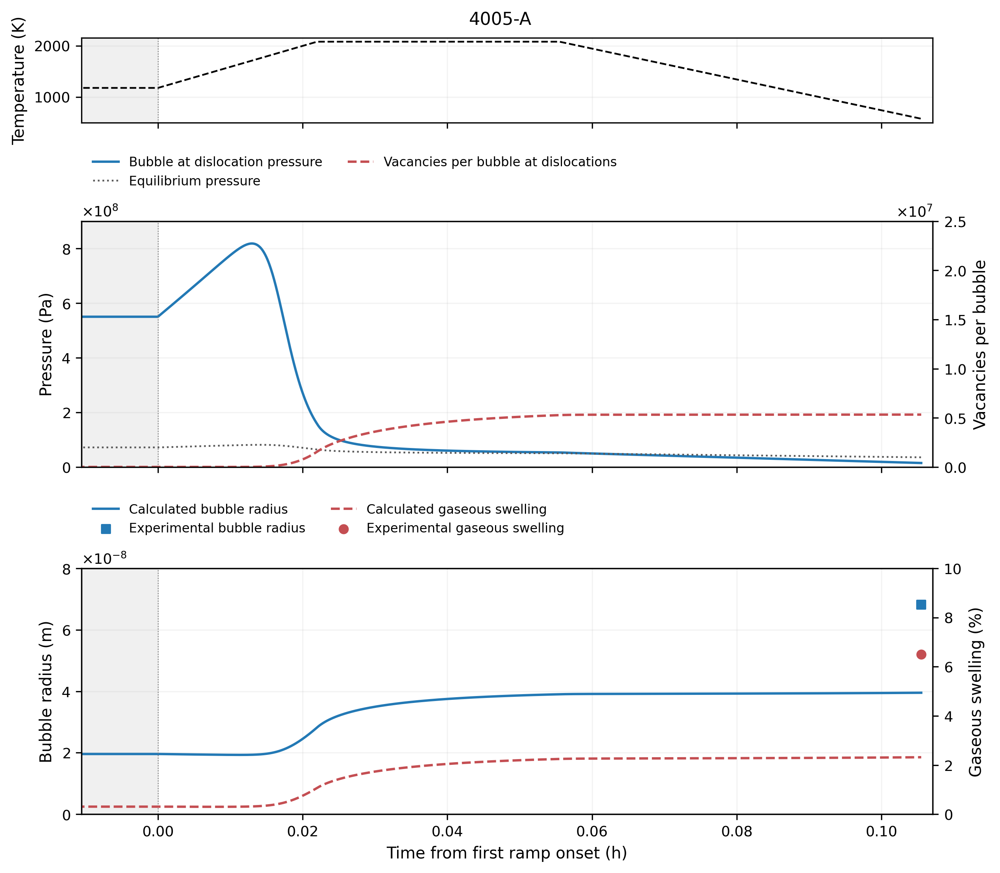

# White coarsening regression — Nicodemo 2026

38 ramp histories using experimental data reported by Barani 2020. Same fixed inputs and physical yield for the new model and legacy controls. Red crosses are published Barani Table4 predictions, not measurements or simulated Barani configurations. No published Barani intergranular values are available in this table.

The selected Nicodemo 2026 model uses Carnahan–Starling pressure for dislocation bubbles, with the same pressure driving vacancy uptake. The volume is V=n*omega(T)+nv*Omega, where omega(T)=2*pi*dHS(T)^3/3 is the additive hard-sphere gas co-volume; K=1.6e+06 m^-1 is constant, with nu_d=K*positive full density generation during irradiation, excluding cooling rebound. Fresh Nd starts at zero. Bulk-based line supply (D_capture=3 D_bulk) and direct trapping are not temperature-gated. Atomic re-solution has no phi; effective number disappearance and coalescence reduce Nd. Vacancy uptake requires T>=1500 K and positive CS overpressure; Dv is 30 times the bulk vacancy diffusivity, with an explicitly calibrated effective prefactor. The density uses the frozen Veshchunov-White refit documented in context/dislocation_density. Parameters are globally selected closures, not independently measured constants. The effective hard-sphere diameter is that of Xe for the combined stable Xe/Kr inventory.
The line-supply factor and vacancy mobility are calibrated globally on the 38 histories. Pre-ramp agreement and gas partitions are diagnostics; numerical verification is not a claim of physical validation.

The temperature dependence of this reference co-volume also enters geometric overlap and coalescence. It increases on cooling without creating gas or vacancies; mechanical equilibrium is not imposed.



|Model|R MAPE|N MAPE|IG swelling MAPE|GB swelling MAPE|
|---|---:|---:|---:|---:|
|Nicodemo 2026|41.33%|210.17%|163.20%|149.66%|
|SCIANTIX single-size|98.05%|3133748.42%|92.26%|179.42%|
|Barani 2020|54.48%|140.98%|254.73%|not tabulated|

IG swelling includes both populations; R and N describe the large population in the new model. White SEM primarily resolves the large population. All gas fractions are normalized to local stable Xe+Kr production; means across 38 locations are arithmetic diagnostics, not integral rod FGR.





Detailed_ramps contains a full-history figure for every sample. Pressure is in Pa, radius in m, vacancies are counted per dislocation bubble, and swelling is total intragranular swelling in percent. All text is black. Axis maxima start at 1e8 Pa, 2.5e7 vacancies/bubble, 8e-8 m and10% and expand when a calculated or experimental value exceeds them. The temperature is shown separately.

The dislocation-density correlation was refitted to White 2006 data that cannot be shown. A comparison with pre-ramp data was also performed; those data and the corresponding figure are not distributed.

Two of 40 ramp histories are unavailable; local 4163 histories omit the 41 h hold listed in Barani Table 3.

## Individual histories

Pressure uses the Carnahan–Starling EOS. Pressure is undefined for initially empty sites. Experimental post-test points are plotted at the end of the history in the radius/swelling panel. In early-ramp zooms, final observations appear at the right edge as references, not as measurements at that time. No Barani time curves are included. Long histories have an early-ramp zoom in addition to the full-history figure; both show the actual final references.

- [4000-A](figures/Detailed_ramps/4000-A.png)
- [4000-B](figures/Detailed_ramps/4000-B.png)
- [4000-C](figures/Detailed_ramps/4000-C.png)
- [4000-D](figures/Detailed_ramps/4000-D.png)
- [4004-A](figures/Detailed_ramps/4004-A.png)
- [4004-B](figures/Detailed_ramps/4004-B.png)
- [4004-C](figures/Detailed_ramps/4004-C.png)
- [4004-D](figures/Detailed_ramps/4004-D.png)
- [4005-A](figures/Detailed_ramps/4005-A.png)
- [4005-B](figures/Detailed_ramps/4005-B.png)
- [4005-C](figures/Detailed_ramps/4005-C.png)
- [4005-D](figures/Detailed_ramps/4005-D.png)
- [4064-A](figures/Detailed_ramps/4064-A.png)
- [4064-B](figures/Detailed_ramps/4064-B.png)
- [4064-C](figures/Detailed_ramps/4064-C.png)
- [4064-D](figures/Detailed_ramps/4064-D.png)
- [4065-A](figures/Detailed_ramps/4065-A.png)
- [4065-B](figures/Detailed_ramps/4065-B.png)
- [4065-C](figures/Detailed_ramps/4065-C.png)
- [4065-D](figures/Detailed_ramps/4065-D.png)
- [4065-E](figures/Detailed_ramps/4065-E.png)
- [4135-A](figures/Detailed_ramps/4135-A.png) ([early-ramp zoom](figures/Detailed_ramps/4135-A_ramp.png))
- [4135-B](figures/Detailed_ramps/4135-B.png) ([early-ramp zoom](figures/Detailed_ramps/4135-B_ramp.png))
- [4135-C](figures/Detailed_ramps/4135-C.png) ([early-ramp zoom](figures/Detailed_ramps/4135-C_ramp.png))
- [4136-A](figures/Detailed_ramps/4136-A.png) ([early-ramp zoom](figures/Detailed_ramps/4136-A_ramp.png))
- [4136-B](figures/Detailed_ramps/4136-B.png) ([early-ramp zoom](figures/Detailed_ramps/4136-B_ramp.png))
- [4136-C](figures/Detailed_ramps/4136-C.png) ([early-ramp zoom](figures/Detailed_ramps/4136-C_ramp.png))
- [4136-D](figures/Detailed_ramps/4136-D.png) ([early-ramp zoom](figures/Detailed_ramps/4136-D_ramp.png))
- [4140-A](figures/Detailed_ramps/4140-A.png) ([early-ramp zoom](figures/Detailed_ramps/4140-A_ramp.png))
- [4140-B](figures/Detailed_ramps/4140-B.png) ([early-ramp zoom](figures/Detailed_ramps/4140-B_ramp.png))
- [4162-A](figures/Detailed_ramps/4162-A.png)
- [4162-B](figures/Detailed_ramps/4162-B.png)
- [4162-C](figures/Detailed_ramps/4162-C.png)
- [4162-D](figures/Detailed_ramps/4162-D.png)
- [4163-A](figures/Detailed_ramps/4163-A.png)
- [4163-B](figures/Detailed_ramps/4163-B.png)
- [4163-C](figures/Detailed_ramps/4163-C.png)
- [4163-D](figures/Detailed_ramps/4163-D.png)

## Run and verify

```sh
python3 regression/White_Coarsening/run.py --binary build/sciantix.x
python3 regression/White_Coarsening/run.py --binary build/sciantix.x --check --verify --no-plots
```

Frozen endpoint references are changed only with the explicit `--write-reference` option. Raw traces stay in ignored `runs/`. Figures are generated only as 300 dpi PNG files. Equations, parameter provenance and limits are summarized in [context](../../context/COARSENING.md).
