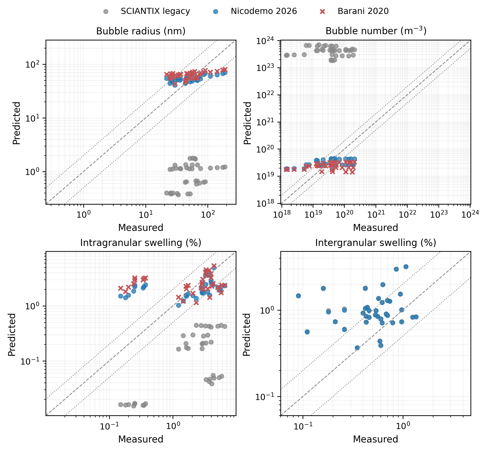
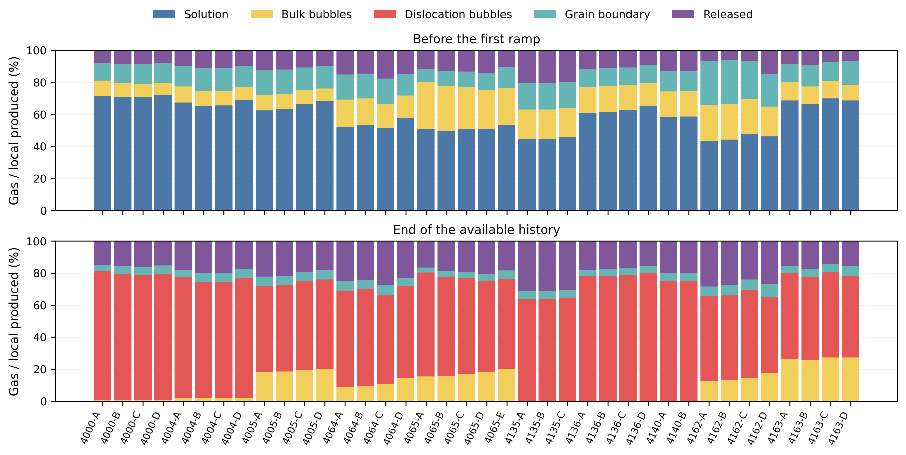

# White coarsening regression — Nicodemo 2026

38 ramp histories using experimental data reported by Barani 2020. Same fixed inputs and physical yield for the new model and legacy controls. Red crosses are published Barani Table4 predictions, not measurements or simulated Barani configurations. No published Barani intergranular values are available in this table.



|Model|R MAPE|N MAPE|IG swelling MAPE|GB swelling MAPE|
|---|---:|---:|---:|---:|
|Nicodemo 2026|39.18%|149.44%|167.52%|177.28%|
|SCIANTIX legacy|98.05%|3133748.42%|92.26%|179.42%|
|Barani 2020|54.48%|140.98%|254.73%|not tabulated|

IG swelling includes both populations; R and N describe the large population in the new model. White SEM primarily resolves the large population. All gas fractions are normalized to local stable Xe+Kr production; means across38 locations are arithmetic diagnostics, not integral rod FGR.



The dislocation-density correlation was refitted to White 2006 data that cannot be shown. A comparison with pre-ramp data was also performed; those data and the corresponding figure are not distributed.

Two of40 ramp histories are unavailable; local4163 histories omit the41 h hold listed in Barani Table3.

## Individual histories

Pressure and vacancies are undefined until the large population exists. Experimental post-test points are separated from the time axis, without assigning a measurement timestamp. No Barani time curves are included. Long histories have an early-ramp zoom and an additional full-history figure; both show the actual final references.

- [4000-A](figures/histories/4000-A.png)
- [4000-B](figures/histories/4000-B.png)
- [4000-C](figures/histories/4000-C.png)
- [4000-D](figures/histories/4000-D.png)
- [4004-A](figures/histories/4004-A.png)
- [4004-B](figures/histories/4004-B.png)
- [4004-C](figures/histories/4004-C.png)
- [4004-D](figures/histories/4004-D.png)
- [4005-A](figures/histories/4005-A.png)
- [4005-B](figures/histories/4005-B.png)
- [4005-C](figures/histories/4005-C.png)
- [4005-D](figures/histories/4005-D.png)
- [4064-A](figures/histories/4064-A.png)
- [4064-B](figures/histories/4064-B.png)
- [4064-C](figures/histories/4064-C.png)
- [4064-D](figures/histories/4064-D.png)
- [4065-A](figures/histories/4065-A.png)
- [4065-B](figures/histories/4065-B.png)
- [4065-C](figures/histories/4065-C.png)
- [4065-D](figures/histories/4065-D.png)
- [4065-E](figures/histories/4065-E.png)
- [4135-A](figures/histories/4135-A.png) ([full history](figures/histories/4135-A_full.png))
- [4135-B](figures/histories/4135-B.png) ([full history](figures/histories/4135-B_full.png))
- [4135-C](figures/histories/4135-C.png) ([full history](figures/histories/4135-C_full.png))
- [4136-A](figures/histories/4136-A.png) ([full history](figures/histories/4136-A_full.png))
- [4136-B](figures/histories/4136-B.png) ([full history](figures/histories/4136-B_full.png))
- [4136-C](figures/histories/4136-C.png) ([full history](figures/histories/4136-C_full.png))
- [4136-D](figures/histories/4136-D.png) ([full history](figures/histories/4136-D_full.png))
- [4140-A](figures/histories/4140-A.png) ([full history](figures/histories/4140-A_full.png))
- [4140-B](figures/histories/4140-B.png) ([full history](figures/histories/4140-B_full.png))
- [4162-A](figures/histories/4162-A.png)
- [4162-B](figures/histories/4162-B.png)
- [4162-C](figures/histories/4162-C.png)
- [4162-D](figures/histories/4162-D.png)
- [4163-A](figures/histories/4163-A.png)
- [4163-B](figures/histories/4163-B.png)
- [4163-C](figures/histories/4163-C.png)
- [4163-D](figures/histories/4163-D.png)

## Run and verify

```sh
python3 regression/White_Coarsening/run.py --binary build/sciantix.x
python3 regression/White_Coarsening/run.py --binary build/sciantix.x --check --verify --no-plots
```

Frozen endpoint references are changed only with the explicit `--write-reference` option. Raw traces stay in ignored `runs/`. Figures are generated only as 300 dpi PNG files. Equations, parameter provenance and limits are summarized in [context](../../context/COARSENING.md).
